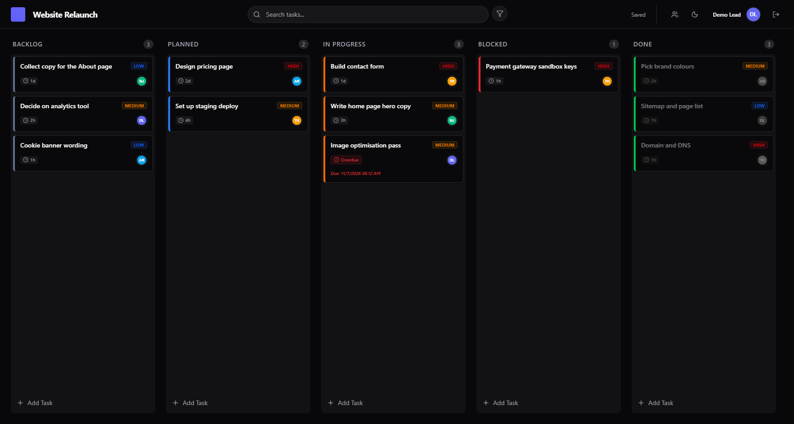
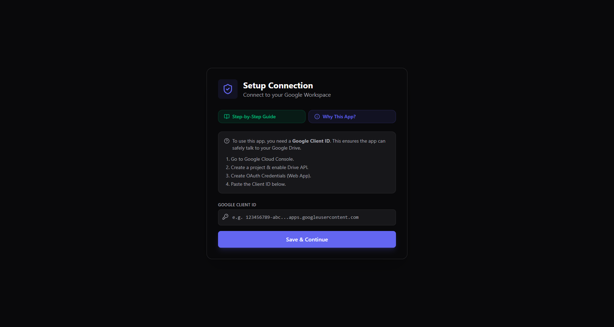
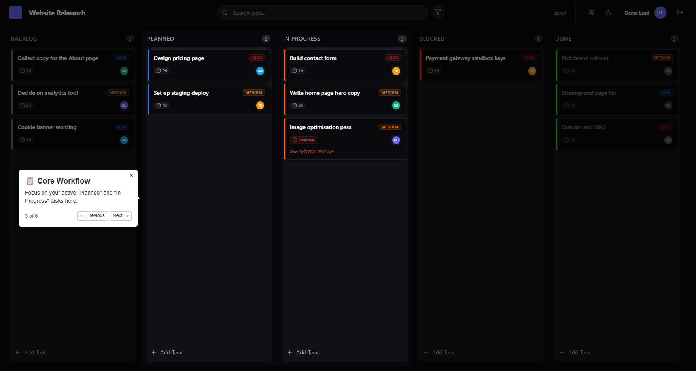
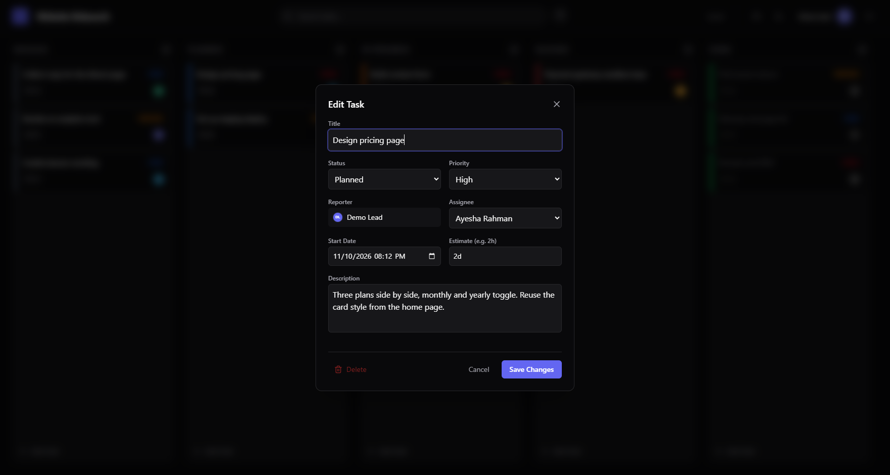
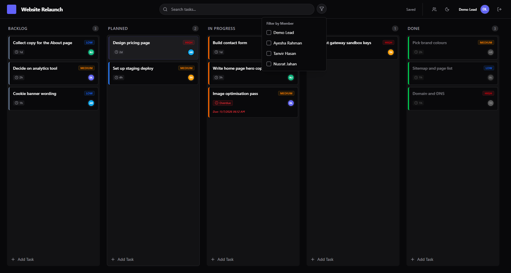
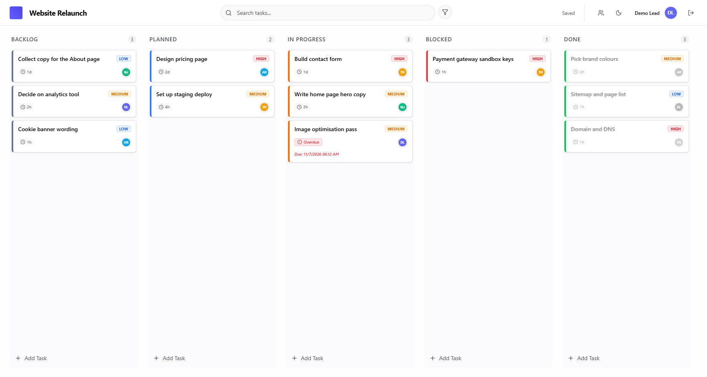

# Project Execution Board

A task board for running one project at a time, with no backend. The board is saved as a file in your own Google Drive, and a copy is kept in the browser (IndexedDB) so it opens fast. Nothing is stored on a server of mine.

I built it with Google Antigravity.



The screenshots use a made-up demo project and names.

## How it works

### Connect your Google account

The app talks to Google Drive with your own Google Client ID, so the first screen asks for one. The Step-by-Step Guide button walks through creating it in Google Cloud Console, with pictures. The same steps are written out further down.



After that you sign in with Google. The board file is created in your Drive. If you have access to more than one board file, you pick which project to open, or you can start a new one.

### Plan the work

Tasks move through five columns: Backlog, Planned, In Progress, Blocked and Done. Drag a card to another column, or up and down to reorder it. The order is saved, so it stays the same the next time you open the board.

The first time you open the board, a short tour shows you around.



Click a card to edit it. Each task has a title, status, priority, assignee, start date, estimate (like 2h or 1d) and a description. The reporter is filled in from whoever created the task. When a task with a start date and an estimate runs past its due time, the card is marked Overdue and shows when it was due.



### Work as a team

To work together, share the board's file with your teammates in Google Drive. People who have access to the file show up as project members, and you can also add members by hand. Anyone with view-only access can see the board but can't change it.

Search finds tasks by text, and the filter button narrows the board to one or more members.



You can rename the project, upload a logo for it, and switch between dark and light mode.



## Run it locally

### 1. Get a Google Client ID

1. Go to [Google Cloud Console](https://console.cloud.google.com) and create a project.
2. Enable the Google Drive API.
3. Set up the OAuth consent screen as External, and add your own email to the Test Users list.
4. Create an OAuth 2.0 Client ID for a web application. Add `http://localhost:3000` to both the authorised JavaScript origins and the authorised redirect URIs, plus your own address if you deploy it.

### 2. Start the app

```bash
git clone https://github.com/sifatshishir/project-execution-board.git
cd project-execution-board
npm install
npm run dev
```

### 3. Connect

Open http://localhost:3000, paste your Client ID on the setup screen and sign in with Google.

## Built with

- Next.js (App Router), React and TypeScript
- Zustand for state
- Google Drive API for saving, IndexedDB for the local copy
- dnd-kit for drag and drop
- driver.js for the onboarding tour
- Tailwind CSS, next-themes, Framer Motion and Lucide icons

## License

MIT. Feel free to use and change it for your own projects.
